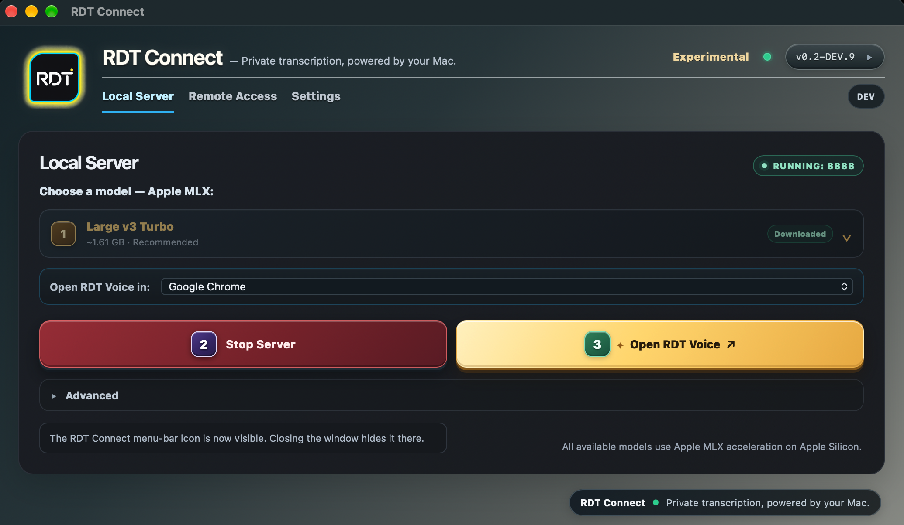
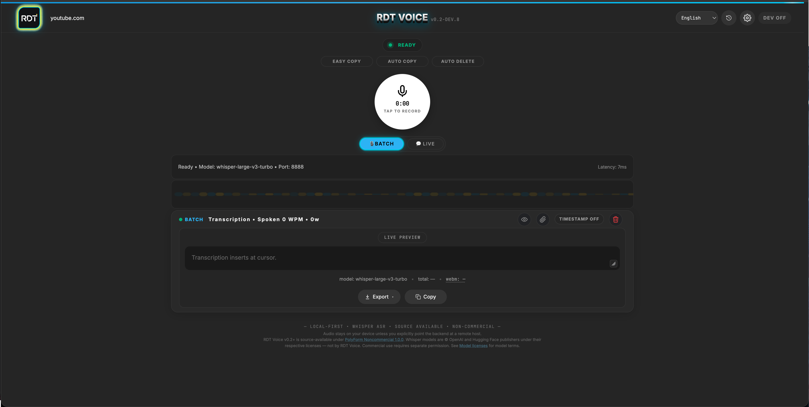
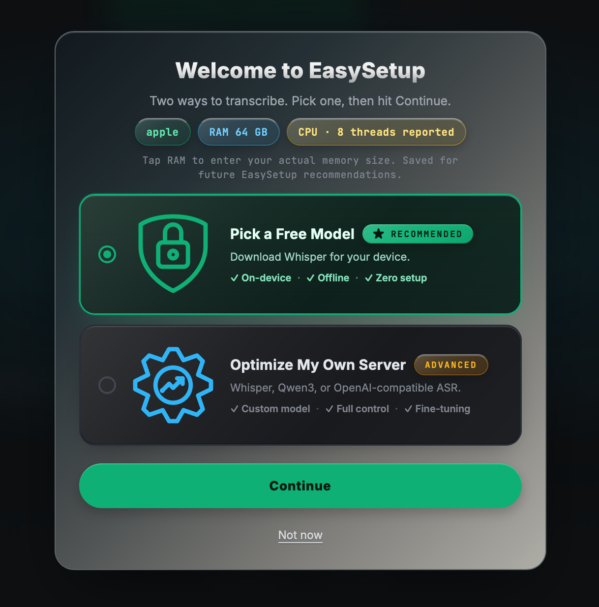
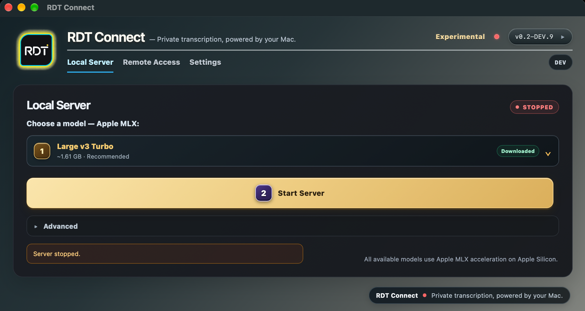
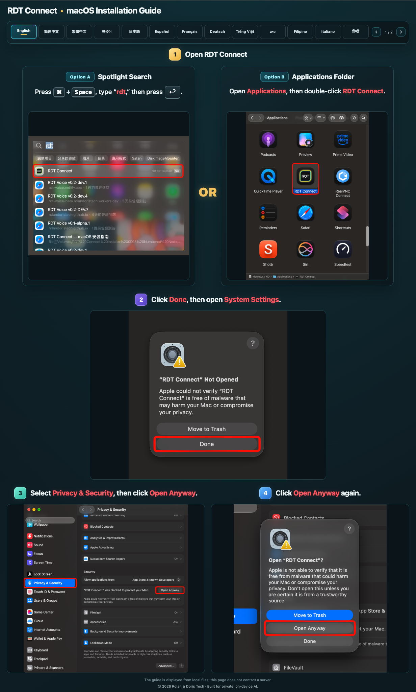
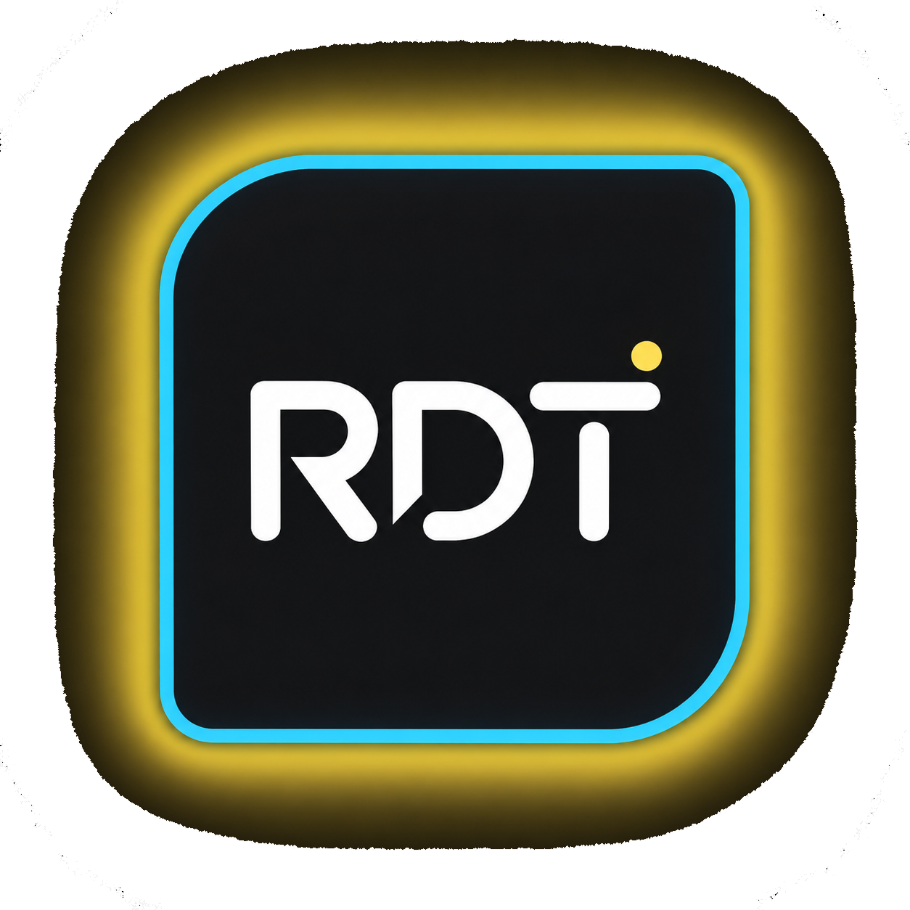

<!-- RDT_CONNECT_PROMO_START -->
<div align="left">
  <h1>Meet RDT Connect</h1>
  <h3>Your desktop companion for RDT Voice and local Whisper</h3>
  <p>Choose a Whisper model, start or stop your local server, and open RDT Voice in your browser—all from one app.</p>
  <p><strong>Available for macOS and Windows; Linux packages are untested prereleases</strong></p>
  <p>
  <a href="https://github.com/RolanDorisTech/rdt-voice/releases/download/connect-v0.2.0-dev.11-1d04/RDT_Connect_0.2.0-dev.11.1D04_aarch64.dmg"></a>
  <a href="https://github.com/RolanDorisTech/rdt-voice/releases/download/connect-v0.2.0-dev.11-2a07/RDT.Connect_0.2.0-dev.11.2A07_arm64-setup.exe"></a>
  <a href="https://github.com/RolanDorisTech/rdt-voice/releases/download/connect-v0.2.0-dev.11-3a03/RDT.Connect_0.2.0-dev.11.3A03_x64-setup.exe"></a>
  <a href="https://github.com/RolanDorisTech/rdt-voice/releases/download/connect-v0.2.0-dev.11-4u01/RDT.Connect_0.2.0-dev.11.4U.1_arm64.deb"></a>
  <a href="https://github.com/RolanDorisTech/rdt-voice/releases/download/connect-v0.2.0-dev.11-5d01/RDT.Connect_0.2.0-dev.11.5D.1_amd64.deb"></a>
  </p>
  <p><a href="#rdt-connect-downloads">Screenshots and installation guide ↓</a> · <a href="https://github.com/RolanDorisTech/rdt-voice/releases">All releases</a></p>
  <a href="#rdt-connect-downloads"></a>
</div>
<!-- RDT_CONNECT_PROMO_END -->

---

[](https://rolandoristech.github.io/rdt-voice/)

## Try RDT Voice in your browser

Click either image below to try the live browser demo:

<div align="center">
  <a href="https://rolandoristech.github.io/rdt-voice/"></a>
  <br><br>
  <a href="https://rolandoristech.github.io/rdt-voice/"></a>
</div>

<p align="center">👉 <strong><a href="https://rolandoristech.github.io/rdt-voice/">Click here to try RDT Voice in your browser</a></strong></p>

<h1 align="center">RDT Voice</h1>
<p align="center"><strong>Browser transcription with EasyWhisper and your own Whisper backend</strong></p>
<hr>
**Record in your browser. Transcribe on your device or send audio to a Whisper backend you control. Export captions, transcripts, YouTube chapters, and description drafts.**

- 🚀 **[Try RDT Voice](https://rolandoristech.github.io/rdt-voice/)**
- ⬇️ **[View the current app source](index.html)** · [Download the complete repository ZIP](https://github.com/RolanDorisTech/rdt-voice/archive/refs/heads/main.zip)
- 🧰 **[Apple Silicon backend setup guide](backend/README-APPLE-SILICON.md)** · [shared backend guide](backend/README.md) · [server source](backend/apple/server.py) · [requirements](backend/requirements.txt)

No account is required. No RDT-operated audio-transcription service is required. The browser UI has no build step. The included Python backend is an optional, separate process for Apple Silicon Macs.

> **Current browser build:** **Build R76** (currently published on `main`; product version remains `v0.2.0-dev.11`). This is a development build, not a claim that every browser, device, and model combination has been exhaustively tested.

> **Which page is current?** The public app is served from the repository root at `https://rolandoristech.github.io/rdt-voice/`. The older `rdt-voice.html` file is deliberately preserved as a historical version and is not the current app.

## What it does

RDT Voice has two transcription paths:

- **EasyWhisper:** runs supported Whisper models in your browser using your device's available resources.
- **Local Server:** sends audio to the backend URL you configure. You choose and control that destination.

You can work with timestamped transcript segments, live or batch recording, search and replace, and exports such as SRT, VTT, CSV, JSON, TXT, YouTube chapter/time ranges, and description drafts. Results still need human review, especially for names, numbers, specialized terms, and noisy audio.

## Quick start

### Option A — try EasyWhisper in the hosted app

1. Open [RDT Voice](https://rolandoristech.github.io/rdt-voice/) in a supported browser.
2. Open Easy Setup / model selection and start with **Tiny** if you are unsure which model your device can handle.
3. Allow the model to download and finish loading. First load is usually slower than later loads because browser storage may cache model files.
4. Record a short sample, stop, and confirm the transcript before trying a longer clip or larger model.

The complete website bundle includes the app and the companion runtime/localization assets. If you download the HTML alone, EasyWhisper still needs the matching `worker.js`, `pcm-worklet.js`, `models.manifest.json`, and `locales/` directory beside it. For a complete local copy, download the repository archive and keep the file structure intact.

### Option B — run the page locally

From a folder containing the app and its companion assets, run:

```bash
python3 -m http.server 5173
```

Open `http://localhost:5173/`. The root `index.html` is the current app. The existing `rdt-voice.html` is intentionally retained unchanged as the earlier historical version. Do not double-click an HTML file and open it as a `file://` URL; browser permissions and origin behavior are less predictable that way.

### Option C — use RDT Connect (optional desktop app)

1. **Choose a Whisper model.**

   [](#rdt-connect-downloads)

2. **Start the server.**

   [](#rdt-connect-downloads)

3. **Open RDT Voice** from RDT Connect.

RDT Connect is optional. You can also use RDT Voice directly in a supported browser.

## RDT Connect Downloads

Dev 11 packages are **prereleases**. Complete the applicable release qualification before treating them as final production releases.

| Platform | Download | Version | Build | Size |
| --- | --- | --- | --- | ---: |
| macOS (Apple Silicon) | [DMG](https://github.com/RolanDorisTech/rdt-voice/releases/download/connect-v0.2.0-dev.11-1d04/RDT_Connect_0.2.0-dev.11.1D04_aarch64.dmg) · [SHA-256 manifest](https://github.com/RolanDorisTech/rdt-voice/releases/download/connect-v0.2.0-dev.11-1d04/SHA256SUMS.txt) | `0.2.0-dev.11` | `1D04` | 235,712,825 bytes |
| Windows ARM64 | [Installer](https://github.com/RolanDorisTech/rdt-voice/releases/download/connect-v0.2.0-dev.11-2a07/RDT.Connect_0.2.0-dev.11.2A07_arm64-setup.exe) · [SHA-256](https://github.com/RolanDorisTech/rdt-voice/releases/download/connect-v0.2.0-dev.11-2a07/RDT.Connect_0.2.0-dev.11.2A07_arm64-setup.exe.sha256) · [Guide (HTML)](https://github.com/RolanDorisTech/rdt-voice/releases/download/connect-v0.2.0-dev.11-2a07/windows-installation-guide.html) · [Guide ZIP](https://github.com/RolanDorisTech/rdt-voice/releases/download/connect-v0.2.0-dev.11-2a07/RDT-Connect-Windows-Installation-Guide.zip) · [Guide ZIP SHA-256](https://github.com/RolanDorisTech/rdt-voice/releases/download/connect-v0.2.0-dev.11-2a07/RDT-Connect-Windows-Installation-Guide.zip.sha256) | `0.2.0-dev.11` | `2A07` | 101,979,239 bytes |
| Windows x64 | [Installer](https://github.com/RolanDorisTech/rdt-voice/releases/download/connect-v0.2.0-dev.11-3a03/RDT.Connect_0.2.0-dev.11.3A03_x64-setup.exe) · [SHA-256](https://github.com/RolanDorisTech/rdt-voice/releases/download/connect-v0.2.0-dev.11-3a03/RDT.Connect_0.2.0-dev.11.3A03_x64-setup.exe.sha256) · [Guide (HTML)](https://github.com/RolanDorisTech/rdt-voice/releases/download/connect-v0.2.0-dev.11-3a03/windows-installation-guide.html) · [Guide ZIP](https://github.com/RolanDorisTech/rdt-voice/releases/download/connect-v0.2.0-dev.11-3a03/RDT-Connect-Windows-Installation-Guide.zip) · [Guide ZIP SHA-256](https://github.com/RolanDorisTech/rdt-voice/releases/download/connect-v0.2.0-dev.11-3a03/RDT-Connect-Windows-Installation-Guide.zip.sha256) | `0.2.0-dev.11` | `3A03` | 137,365,296 bytes |
| Ubuntu ARM64 — **NOT YET TESTED** | [DEB](https://github.com/RolanDorisTech/rdt-voice/releases/download/connect-v0.2.0-dev.11-4u01/RDT.Connect_0.2.0-dev.11.4U.1_arm64.deb) | `0.2.0-dev.11` | `4U01` | 82.3 MB |
| Debian x64 — **NOT YET TESTED** | [DEB](https://github.com/RolanDorisTech/rdt-voice/releases/download/connect-v0.2.0-dev.11-5d01/RDT.Connect_0.2.0-dev.11.5D.1_amd64.deb) | `0.2.0-dev.11` | `5D01` | 83.0 MB |

## Installation guides

### macOS

<p align="center"></p>

**macOS note:** RDT Connect is ad-hoc-signed and not notarized by Apple, so macOS may show a first-launch security warning. The published Build 1D04 DMG is available for macOS Apple Silicon. The development updater feed provides the corrected signed 1D04 updater archive and matching signature for eligible existing installations.

### Windows

1. Download the installer for your system and open the `.exe` file.
2. If Windows SmartScreen appears, select **More info**.
3. Verify the installer is from the official RDT Connect release before selecting **Run anyway**.

For screenshots and other languages, use the **Guide** link beside your Windows download.

**Windows download note:** Wait until Chrome's Downloads panel reports that the installer has finished downloading. A completed download should normally have an `.exe` filename. If Chrome reports the download as complete but leaves it named `Unconfirmed <number>.crdownload`, rename it to the full installer filename for your architecture: `RDT.Connect_0.2.0-dev.11.2A07_arm64-setup.exe` for Windows ARM64 or `RDT.Connect_0.2.0-dev.11.3A03_x64-setup.exe` for Windows x64. Do not rename or run a file if Chrome reports the download failed or was interrupted; download it again instead.

**Development and testing environment:** Development is performed on a MacBook Pro with Apple M1 Max; no native Windows or Linux development machines are available. Windows and Linux evaluation is limited to VMware or UTM virtual machines. The Linux `.deb` packages have not yet been tested.

Advanced users can find the SHA-256 checksum files on the corresponding GitHub release page.

See [all RDT Connect releases](https://github.com/RolanDorisTech/rdt-voice/releases) for future versions and updates.

## How RDT Connect works

RDT Connect is an optional desktop companion for the RDT Voice browser app. It manages the local transcription service and provides native app and system-tray controls; it does not replace the browser interface.

- **Desktop layer:** Tauri and Rust handle native application lifecycle, tray controls, updates, and local server-process management.
- **Service layer:** Python, FastAPI, and Uvicorn provide the local API that RDT Voice uses to reach the transcription backend.
- **Speech engines:** supported Apple Silicon builds provide an MLX-Whisper path; other builds use their configured Whisper backend.
- **Local endpoints:** the standard Whisper service uses port `8888`, while the MLX-Whisper service uses port `8889`. A port already in use can prevent the corresponding service from starting.
- **Browser integration:** RDT Connect launches RDT Voice in your browser. RDT Voice can also be used directly without RDT Connect.
- **Network considerations:** local transcription uses the local service, but acquiring models and checking for application updates may require network access. “Local transcription” is not a guarantee that every setup or update operation is offline.

## Connection and security

RDT Connect has separate controls for local browser connectivity and optional remote access.

- **Local browser connection:** RDT Connect can configure HTTPS for localhost. Setting up trusted HTTPS may require explicit approval to add a local certificate authority to your system's trust store. The setup UI describes this authority as restricted to loopback addresses (`127.0.0.1` and `::1`). Review certificate-trust prompts before approving them.
- **Optional remote access:** Remote pairing uses Tailscale and requires Tailscale to be installed and connected. Starting the local transcription server alone does not enable public access. The pairing QR is described by the app as single-use and time-limited; pairing requests still require approval.
- **Protect access information:** Do not share pairing QR codes, private pairing links, credentials, or diagnostic reports containing sensitive information.

These controls reduce specific connection risks; they are not a guarantee against a compromised computer, browser, or other software running on your device. Keep your operating system and browser up to date, and approve certificate or pairing requests only when you initiated and understand them.

## Offline use

RDT Connect is designed to manage transcription through a local Whisper service instead of requiring audio to be sent to a remote transcription API.

Once the app is installed, the required model is available locally, and the selected backend and RDT Voice interface are running, transcription can work without an internet connection. This depends on your backend and configuration.

An internet connection may still be needed to download the app, obtain models that are not already installed, check for application updates, or access online documentation. Offline transcription does not mean first-time setup and every supporting feature work offline.

**Planning to work offline?** Install the app, download your intended model, start the local service, and complete a test transcription before disconnecting.

## Troubleshooting RDT Connect

If transcription does not start or RDT Voice cannot reach the local service:

1. Confirm the intended backend is selected and the local service is running.
2. Check the configured service port. The standard Whisper service uses `8888`; the MLX-Whisper service uses `8889` on supported builds. Another process using a port can prevent startup.
3. Confirm the required model has been downloaded and is available to the selected backend.
4. Check RDT Connect's diagnostics and the installation guide for your operating system.
5. If the problem persists, include the relevant diagnostic output when reporting the issue. Remove any private information before sharing logs.

## Run your own Whisper backend

### Why run your own backend?

For users with compatible hardware, running Whisper locally can make a **dramatic difference in transcription speed and reliability**, especially with longer recordings. In my testing on Apple Silicon, the local Whisper backend has been much faster and more consistent than browser-based EasyWhisper for some demanding recordings.

Your results will depend on your hardware, selected model, audio quality, and language. EasyWhisper remains the easiest option when you don't want to install a separate backend.

For Apple Silicon Macs, see the [Apple Silicon backend setup guide](backend/README-APPLE-SILICON.md).

### Platform scope

The `backend/apple/server.py` provided here is specifically for **macOS on Apple Silicon** (M-series Macs). It uses MLX Whisper. MLX is not the backend implementation for Windows or generic Linux systems.

**Separate Windows and Linux backend implementations or step-by-step instructions may be provided in a future update.** In the meantime, those users can use EasyWhisper in a supported browser or connect RDT Voice to another compatible speech-to-text backend they have configured. The requirements, authentication, and HTTPS steps depend on that backend.

### Apple Silicon Mac: first-time setup

These steps are intended for a clean setup, including a second Mac such as an M1 MacBook Air. They use a dedicated virtual environment instead of changing your system Python or another project.

#### 1. Check the Mac

Open Terminal on the Mac that will run Whisper:

```bash
uname -m
sw_vers -productVersion
```

For this backend, `uname -m` should report `arm64`. Use macOS 14 or later and Python 3.10 or later; the commands below install Python 3.12 with Homebrew. If the architecture reports `x86_64`, stop: this MLX backend is not the correct implementation for that environment.

#### 2. Install prerequisites

Install Homebrew from [brew.sh](https://brew.sh/) if needed, then run:

```bash
brew install python@3.12 ffmpeg
```

`ffmpeg` is used to decode supported audio formats.

#### 3. Download the backend files

Get these two files from the repository's `backend/` folder and place them together in a folder on the Mac:

- [`server.py`](backend/apple/server.py)
- [`requirements.txt`](backend/requirements.txt)

For example:

```bash
mkdir -p ~/dev/rdt-voice-backend
cd ~/dev/rdt-voice-backend
```

Save both files into that directory. The static GitHub Pages site does **not** run Python; you start this backend yourself on the computer you control.

#### 4. Create an environment and install packages

Run these commands from the folder that contains the downloaded backend files:

```bash
"$(brew --prefix python@3.12)/bin/python3.12" -m venv .venv
source .venv/bin/activate
python -m pip install --upgrade pip
python -m pip install -r requirements.txt
python -c 'import mlx_whisper; print("MLX Whisper import OK")'
```

The final command should print `MLX Whisper import OK`. If it fails, stop and resolve the installation error before proceeding. Do not mix virtual environments or install packages globally to work around an unexplained error.

#### 5. Start the server with authentication enabled

For the standard GitHub Pages frontend origin, the included backend already allows `https://rolandoristech.github.io`. With the virtual environment activated, run:

```bash
RDT_AUTH=on \
WHISPER_MODEL_ID="mlx-community/whisper-large-v3-turbo" \
python server.py --host 127.0.0.1 --port 8888
```

Keep this Terminal window open while using the backend. The server prints a randomly generated bearer token at startup. Copy it privately into **RDT Voice → Settings → Backend token key**. Do not publish or share the token. If you deliberately set `RDT_TOKEN`, keep it secret and use a strong value.

The server listens on loopback only in this example. Do not disable authentication when using remote access, and do not expose port `8888` directly to the public internet.

#### 6. Check the local health endpoint

Open a second Terminal window on the same Mac and run:

```bash
curl -sS --max-time 5 http://127.0.0.1:8888/health
```

A healthy response contains JSON with `"status":"ok"` and the configured model. This checks that the local process responds; it does not prove that a browser's CORS, TLS, or remote-network checks will succeed.

### Connect from the same Mac when the app is hosted over HTTPS

An HTTPS-hosted page can be blocked from calling a local HTTP backend because of mixed-content or loopback/local-network security rules. The default diagnostics should show a protocol-appropriate URL, but a matching scheme alone cannot override browser permissions or certificate trust.

For a browser on the same Mac that needs to call the loopback backend over HTTPS, [mkcert](https://github.com/FiloSottile/mkcert) can create a locally trusted certificate. Follow its official instructions; with Homebrew:

```bash
brew install mkcert
mkcert -install
mkdir -p certs
mkcert -cert-file certs/localhost.pem -key-file certs/localhost-key.pem localhost 127.0.0.1 ::1
```

Start `server.py` with the virtual environment active and with the generated files available in the backend folder:

```bash
SSL_CERTFILE="$PWD/certs/localhost.pem" \
SSL_KEYFILE="$PWD/certs/localhost-key.pem" \
RDT_AUTH=on \
WHISPER_MODEL_ID="mlx-community/whisper-large-v3-turbo" \
python server.py --host 127.0.0.1 --port 8888
```

Use `https://127.0.0.1:8888` as the local backend URL. The certificate must be trusted by the browser on that same computer. Installing mkcert's local certificate authority on a Mac does **not** automatically trust it on your phone. Keep generated certificates and especially `rootCA-key.pem` private; never add them to GitHub.

### Connect a phone or another device over Tailscale

For phone-to-Mac access, a simple pattern is to keep the backend on loopback HTTP and let **Tailscale Serve provide HTTPS externally**. Install and sign in to Tailscale on both devices and confirm they are in the same tailnet. With the server listening on `http://127.0.0.1:8888`, run this on the Mac:

```bash
tailscale serve --bg --https=8444 http://127.0.0.1:8888
tailscale serve status
```

Use the exact HTTPS MagicDNS hostname and port reported by `tailscale serve status`, such as `https://your-device.your-tailnet.ts.net:8444`. The example uses external port `8444` and local port `8888`; they are intentionally distinct. Do not copy another person's hostname. Keep authentication on, and do not enable Tailscale Funnel for this private-backend setup. To turn off the Serve route later, use the disable command shown by `tailscale serve status` or the [official Tailscale Serve documentation](https://tailscale.com/docs/reference/tailscale-cli/serve).

In RDT Voice, set Local Server to the exact HTTPS URL, enter the server token, and run the connection test. On a phone, `127.0.0.1` means the phone itself, not the Mac.

**Browser caveat:** in one iPhone-to-Mac test, Safari could open the backend's `/health` URL directly but the RDT Voice page's JavaScript connection failed; Chrome on the same phone connected and successfully transcribed audio. This is a setup-specific observation, not a guarantee that Safari always fails. If a remote connection fails, check the URL, scheme, port, token, CORS origin, TLS trust, Tailscale Serve status, and the app's diagnostics. Do not disable browser protections just to suppress a generic `Load failed` message.

### Configure CORS for a different frontend origin

The included server permits the production GitHub Pages origin and local development origins by default. If you intentionally test from another origin, add the exact frontend **origin** to `RDT_ALLOWED_ORIGINS` for that server process. An origin contains the scheme, hostname, and optional port; it does not include the page path. Example using a placeholder:

```bash
RDT_ALLOWED_ORIGINS="https://your-test-site.example" \
RDT_AUTH=on \
WHISPER_MODEL_ID="mlx-community/whisper-large-v3-turbo" \
python server.py --host 127.0.0.1 --port 8888
```

Do not embed Alpha/Beta preview hostnames, personal Tailscale hostnames, tokens, private IPs, or certificate files in the public HTML or README. CORS is not authentication; keep the bearer token enabled for remote access.

## Important behavior and known limitations

The following are observations from development and real-device testing, not universal guarantees. Browser versions, devices, OS policies, available memory, audio quality, and selected model all affect behavior.

### Recording and saved audio

- **Private / incognito browsing:** in our testing, saving audio files did not work in at least one private-browsing environment. Other browsers may behave differently, and private sessions can also restrict storage or persistence. Use a normal browser profile for important recordings and verify the exported file before deleting the source.
- **Switching tabs or desktops:** behavior varies by browser and device. In our Chrome desktop testing, audio continued recording while RDT Voice was hidden or on another desktop, but the on-screen timer stopped updating while the page was hidden, so elapsed time could be inaccurate until you returned. Safari on iOS appeared more likely to pause or suspend recording when the app lost the foreground. These are observed quirks, not guarantees. For important recordings, keep RDT Voice visible and the device awake, and verify the saved recording’s duration and playback before relying on it.
- **Long recordings:** recordings beyond about **30 minutes have not been reliable in our testing**. This is an observed reliability limit, not a guaranteed hard-coded cutoff. Split important sessions into smaller recordings.
- **Recovery if transcription fails:** the original audio may still be available under **Recordings** even when the first transcription attempt fails. Open Recordings and press **Transcribe** on the saved clip. Before retrying a long clip or one that has failed repeatedly, select a smaller EasyWhisper model—**Tiny is the safest starting point for recovery**. Download a copy of important audio before deleting or clearing storage.

### EasyWhisper model and accuracy guidance

- **Start small:** Tiny, Base, and Small loaded successfully on a mobile device in recent tests. Model availability and memory use vary by device and browser.
- **Large-v3-Turbo in EasyWhisper:** this model has been inconsistent in recent desktop EasyWhisper tests, even though it has worked in other situations. This browser-side issue is separate from using Turbo on a Local Server. Start with Tiny/Base/Small if Turbo won't load or transcribe reliably on your device.
- **Automatic Tiny retry:** for some eligible EasyWhisper failures, the app may automatically retry using Tiny instead of ending immediately with the original model failure. This fallback may not be as prominent as a separate confirmation prompt. It can recover a transcript but may be less accurate than the model you selected. If output quality seems unexpectedly rough, check the app status and model selection. If it still fails, use Recordings to retry manually after selecting Tiny.
- **Long audio in EasyWhisper:** for clips longer than about **10 minutes**, prefer Tiny. Larger browser models can become disproportionately slower as audio length increases, particularly on mobile or memory-constrained devices. For better speed and recovery, split audio into roughly **2-minute to under-5-minute segments** rather than processing one long clip.
- **Accuracy varies:** quality may range from excellent to poor depending on noise, microphone distance, accents, speakers, language, and the model. Check important names, numbers, and technical details before using or publishing a transcript.
- **Code-switching / mixed languages:** EasyWhisper Auto Detect may not follow rapid language changes within a sentence reliably. In our tests, handling language changes in shorter chunks—around **30 seconds**—worked better. For important mixed-language material, split the audio or specify the language for each segment when practical.
- **Model download progress:** byte counts can be approximate or temporarily exceed the displayed total, and repeat downloads can be much faster than the first. The cause of all such discrepancies has not been confirmed. Use the final model-ready status rather than a byte counter alone.

### Browser testing scope

RDT Voice has been tested to varying degrees in Chrome, Firefox, and Safari; there has also been more limited checking in Edge, Brave, and Opera. This is not exhaustive certification across all versions or devices. Differences in microphone permissions, MediaRecorder formats, local storage, background-tab behavior, downloads, and model memory use remain possible.

## Troubleshooting

### HTTPS frontend → HTTP local backend

An HTTPS page may be blocked from calling `http://127.0.0.1:8888` due to mixed-content or local-network/loopback security policies. Use an HTTPS backend with a trusted local certificate for same-computer access, or use the HTTPS Tailscale Serve URL for another device. A successful terminal `curl` does not by itself prove that browser JavaScript is allowed to make the same request.

### “Backend connection failed”, CORS, or “Load failed”

1. Confirm that the backend is running and its `/health` endpoint responds.
2. Check that the app has the correct scheme (`http` or `https`), host, and port.
3. Confirm the exact frontend origin is allowed by the backend and that the bearer token is correct.
4. For Tailscale, inspect `tailscale serve status` and use its exact MagicDNS hostname and external port.
5. Review the browser console and in-app diagnostics. `Load failed` can mean TLS trust, browser permissions, CORS/origin, DNS, port, or routing; it is not proof of a CORS-only defect.

### EasyWhisper won't load a model or transcription fails

- Confirm `worker.js`, `pcm-worklet.js`, `models.manifest.json`, and `locales/` are deployed beside the HTML at the expected relative paths.
- Check that the browser can download required runtime/model resources and that site storage is available.
- Try Tiny first, particularly after a failed larger-model attempt.
- For a clip that did not transcribe, open Recordings and manually select **Transcribe**. For repeated failures or long clips, select Tiny first.
- Save/export important source audio before refreshing the page or clearing site data.

### Microphone denied or no recording

Use HTTPS or a localhost origin rather than opening a `file://` URL. Check browser microphone permissions, OS microphone access, and whether another app is using the microphone. Some extensions and privacy settings may affect behavior.

### No timestamps or unsupported audio format

The backend must accept the audio format the browser records and return the timestamped segment structure expected by RDT Voice. Safari often records a different MediaRecorder format from Chromium browsers. If an alternative backend rejects Safari's audio, allow its supported `audio/mp4`/AAC format as appropriate rather than assuming every browser produces WebM.

### Backend says healthy but the app still cannot connect

A successful `/health` request proves only that the endpoint answered that particular request. It does not prove that the browser page is permitted to fetch it, that the certificate is trusted, that CORS matches, or that token-protected transcription endpoints will succeed. Use the scheme-aware command displayed by Diagnostics and follow the checks above.

## Privacy and security

- In **EasyWhisper**, speech inference occurs in the browser. Recorded audio is not sent to the Local Server or the model-file relay in this mode. The browser still requests model/runtime resources from third-party services; those services can receive normal connection metadata and requested asset paths.
- In **Local Server** mode, audio goes to the backend URL configured in the app. Use a backend you control or trust. The included server can save received recordings in its local recordings cache; retention on that computer is separate from browser history.
- No account is required, and RDT Voice does not provide a central audio-transcription service. Google Fonts and pinned third-party runtime/model resources may be requested by the page. An update check, when manually invoked in the UI, may contact GitHub.
- The server's bearer token is secret. The app may keep the token for the current session; choosing to remember it on the device stores it in browser local storage, which is not encrypted storage. Only use that option on a device/profile you trust.
- Diagnostics aim to avoid including the token and full page URL, but a backend hostname or environment detail can still reveal information. Review and redact diagnostic output before sharing it publicly.
- CORS does not authenticate users. Keep authentication enabled on remote backends. Do not publish tokens, environment files, local certificate files, or mkcert root CA private keys.

## Why I built this

Thanks to the **Open WebUI project and community** for inspiring this project. Open WebUI helped surface the value of having a practical speech-to-text path that users can run with their own infrastructure. I wanted a small, independent browser UI that can talk directly to a Whisper-compatible endpoint without requiring one particular desktop app, container image, or deployment style. RDT Voice keeps the recording/export interface separate from inference, so users can choose in-browser EasyWhisper or a backend they control.

RDT Voice is an independent project; it is not affiliated with, sponsored by, or endorsed by Open WebUI.

## Acknowledgements and third-party licenses

RDT Voice incorporates or loads third-party software and resources. Their licenses remain separate from the RDT Voice license:

- **React / React DOM** — [MIT License](https://github.com/facebook/react/blob/main/LICENSE).
- **Tailwind CSS** — [MIT License](https://github.com/tailwindlabs/tailwindcss/blob/main/LICENSE).
- **Transformers.js** (`@huggingface/transformers`) — [Apache License 2.0](https://github.com/huggingface/transformers.js/blob/main/LICENSE).
- **ONNX Runtime Web** — [MIT License](https://github.com/microsoft/onnxruntime/blob/main/LICENSE); used as part of the browser inference stack.
- **Google Fonts** — Inter and JetBrains Mono are served as web fonts under their respective upstream font licenses.
- **Whisper model files and converted model assets** — governed by the terms of each upstream model repository. Check the specific model card and license rather than assuming all model files share one license.
- **OpenCC-JS 1.4.2** — MIT; bundled `opencc-data` dictionary data is Apache-2.0. See [`licenses/third-party/opencc-js/NOTICE.md`](licenses/third-party/opencc-js/NOTICE.md).

This list is a practical summary, not a substitute for each upstream license. Preserve the existing repository license files and relevant notices when redistributing the project.

## License

- **RDT Voice v0.1-alpha.1 and earlier:** MIT License — see [`LICENSE-MIT-v0.1`](licenses/historical/LICENSE-MIT-v0.1).
- **RDT Voice v0.2-alpha.1 and later:** PolyForm Noncommercial License 1.0.0 — see [`LICENSE`](LICENSE).
- Commercial use requires separate permission; contact **woknewsbusiness@gmail.com** and see [`COMMERCIAL_LICENSE.md`](COMMERCIAL_LICENSE.md).
- License history: [`LICENSE_HISTORY.md`](LICENSE_HISTORY.md).

Third-party components and model weights remain under their respective licenses. See the included license notices and upstream project/model terms.

## Contributing and reporting issues

PRs and focused bug reports are welcome. Keep the single-HTML application architecture and test changes in Chrome, Safari, and Firefox where possible. A useful bug report includes OS/browser version, processing mode (EasyWhisper or Local Server), model, approximate clip length, and the sanitized error message. **Do not attach private audio, bearer tokens, personal Tailscale hostnames, or unredacted diagnostic logs.**

Contact: **woknewsbusiness@gmail.com**

<p align="center">
  
</p>
